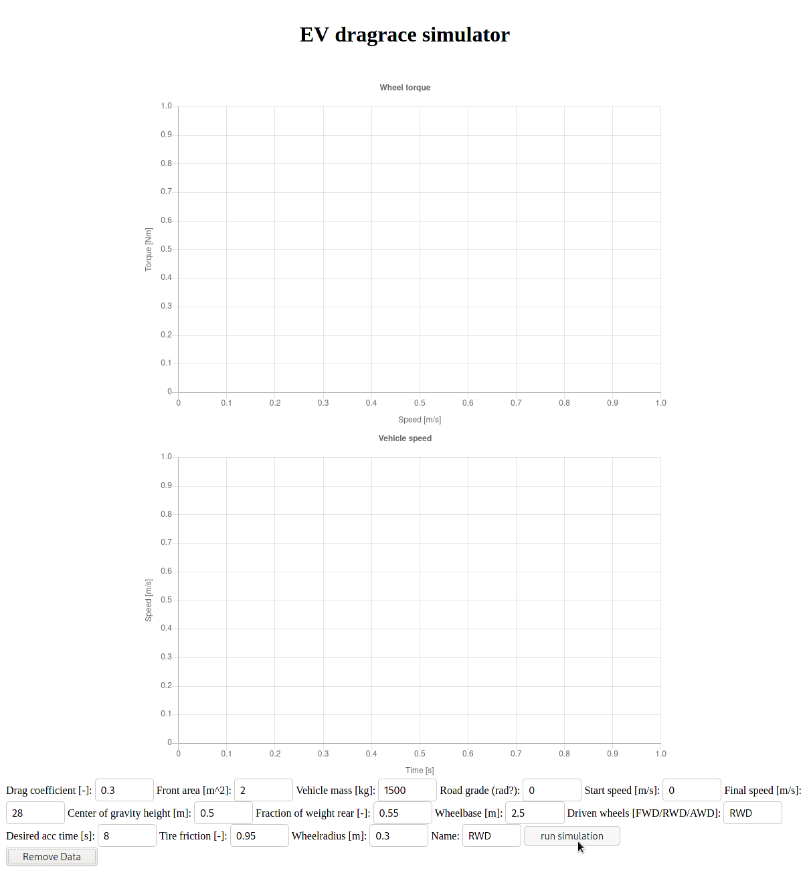

A simulator to find desired wheeltorque curves for vehicles

## Try it online
The simulator runs entirely in your browser and is hosted on GitHub Pages:

**https://pfyhr.github.io/evReqGen/**

Fill in the boxes and click run to see your result. Please post any bugs/issues you find as comments to this repo :)

## Running locally
The page is a static site (`index.html` + `static/`), so any web server will do:
```
$ python -m http.server
```
Then point your browser to 127.0.0.1:8000.

The browser version of the simulation lives in `static/js/sim.js` and is a port of
`dragraceSim.py`, so keep the two in sync if you change the model.
The Python code is still used for the test suite and for running simulations from the command line:
```
$ pip install -r requirements.txt
$ python dragraceSim.py
$ pytest
```
The old Flask app (`python flaskpage.py`) still works too and serves the same page on 127.0.0.1:5000.
Might require new-ish Python version also, 3.8 or newer.

## Deployment
Every push to `main` deploys the site via the GitHub Actions workflow in
`.github/workflows/pages.yml`. GitHub Pages must be set to deploy from
"GitHub Actions" under Settings → Pages.


## Performance
The Python code is now quite fast thanks to @vakuj and some assistance from @najmehabiri, resulting in:
```
NP:       0.1813 s
Vanilla:  0.1791 s
MATLAB:   0.3651 s
Gradient: 0.0175 s
```
See if you can beat that on an average of 10 runs Simon.

## Known issues
JSON reference files are now slightly ill formatted and need to be regenerated. Would be happy to get my hands on some more torque curves for EVs!
